# Architecture

```mermaid
flowchart LR
    Trigger[Manual or scheduled trigger] --> Lease[Lease and idempotency gate]
    Lease --> Read[Bounded inventory read]
    Read --> Snapshot[Verified immutable snapshot]
    Snapshot --> Preview[Preview and confirmation]
    Preview --> Plan[Immutable execution plan]
    Plan --> Intent[Durable write intent]
    Intent --> External[Mock warehouse gateway]
    External --> Readback[Write-after-read verification]
    Readback --> Done[Completed]
    External --> Unknown[UNKNOWN: stop and reconcile]
    Unknown --> Readback
```

## Boundaries

- The domain engine owns state transitions and safety gates.
- The SQLite store owns durable idempotency, leases, plans, and write audit.
- External adapters are replaceable; this repository ships only a deterministic mock.
- No production URLs, selectors, credentials, data, or deployment configuration are included.
